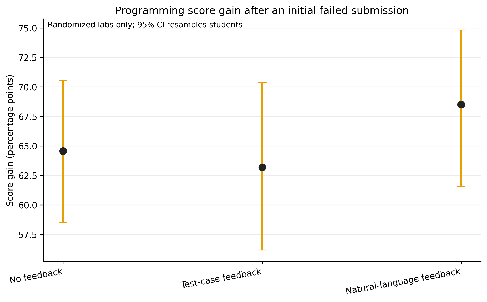
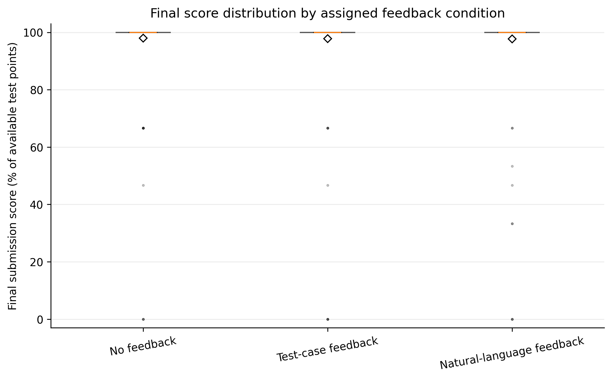
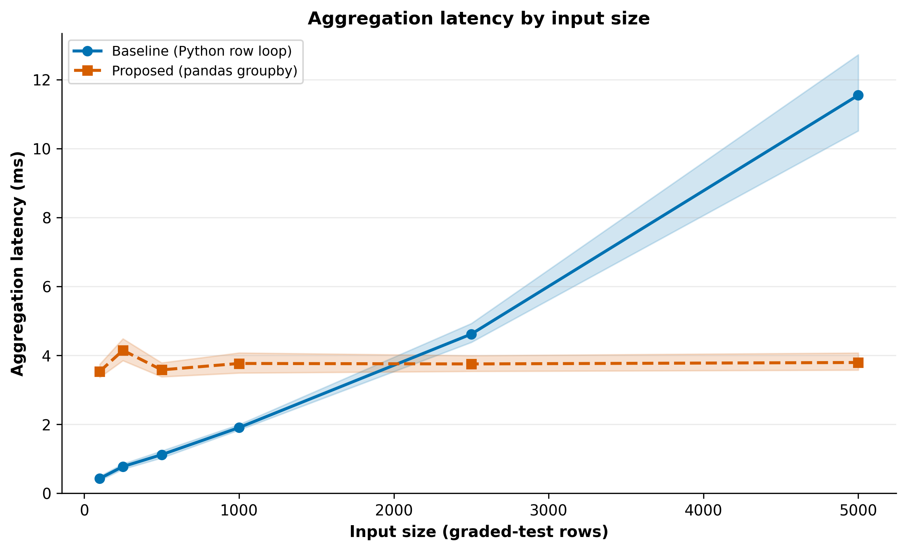
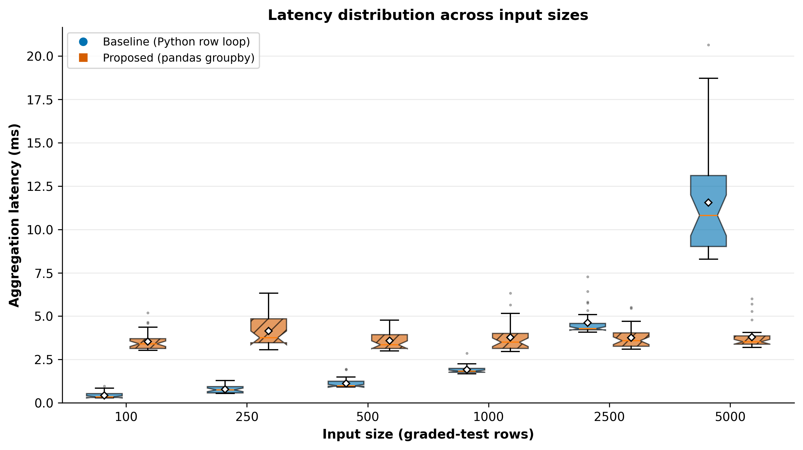

# AI-generated feedback and programming outcomes

**Authors:** Adi Irgimbayev, Alan Shmyrin  
**Research data:** ProgFeed, an anonymized classroom dataset from an introductory Python course  
**Status:** Task 3 artifacts refreshed with empirical classroom data and measured ETL timings

This repository studies how assigned feedback format relates to programming submission outcomes. It does **not** measure critical thinking. The earlier claims about critical-thinking scores, GPA, and an explanation-versus-full-solution treatment came from a synthetic generator and have been removed from the empirical conclusions.

## Research question

Among students with a failed first submission in the randomized intervention labs, how do test-case hints, natural-language hints, and no feedback relate to retries, later scores, and eventual full-credit submissions?

The primary unit is a **student × lab**. The source CSV has one row per graded test/function and submission, so rows are first aggregated into submissions and then into student-lab trajectories. The analysis uses only labs 05, 06, 07, and 09, where assignment to feedback arms was randomized. It keeps assigned condition separate from feedback actually delivered: hints are only shown after a failing submission.

## Data source and attribution

The analysis uses the public [ProgFeed dataset](https://github.com/umass-ml4ed/progFeed-dataset-public), released under CC BY 4.0. Its data dictionary describes 17,385 graded-test rows from 215 consenting students; the paper reports 6,693 submissions in an introductory Python course. The source includes test scores, assigned feedback condition, feedback text when delivered, submission timestamps, and anonymized student IDs. See [the published PMLR paper](https://proceedings.mlr.press/v339/heickal26a.html) and [the dataset data dictionary](https://github.com/umass-ml4ed/progFeed-dataset-public/blob/main/DATA_DICTIONARY.md).

Raw student-level records are excluded from this repository. Download them locally with:

~~~bash
python src/fetch_data.py
~~~

The downloader pins the source repository revision and prints the downloaded file’s SHA-256. The raw file is ignored by Git.

## Empirical results

The corrected PDF answer is available at [output/pdf/Task3_Report_ProgFeed.pdf](output/pdf/Task3_Report_ProgFeed.pdf).

Descriptive results from the four randomized labs, restricted to student-lab units whose first submission failed:

| Assigned feedback | Student-lab units | First attempt failed | Retry rate | Eventually full credit | Mean score gain (percentage points) | Student-cluster bootstrap 95% CI |
|:--|--:|--:|--:|--:|--:|:--|
| No feedback | 271 | 93 | 97.8% | 91.4% | 64.55 | [58.48, 70.54] |
| Test-case hint | 268 | 91 | 95.6% | 90.1% | 63.19 | [56.16, 70.37] |
| Natural-language hint | 264 | 96 | 96.9% | 92.7% | 68.51 | [61.55, 74.83] |

These summaries are descriptive. A score gain is the change from the first to the final observed submission for student-lab units with a failing first submission. The intervals resample students, preserving repeated labs within each student. They do not establish that one feedback arm caused higher performance: feedback is delivered only after errors, and the dataset has repeated submissions and course-specific assignment conditions. The source paper’s methods and limitations should be read alongside these estimates.

## Local data-processing benchmark

The Task 3 latency benchmark times two implementations of the same aggregation over actual ProgFeed rows: a Python row loop and pandas groupby. Each condition uses 5 warm-up runs and 30 measured runs. Load is the number of graded-test rows processed; throughput is rows per second. These timings describe the current local Windows/Python environment and are not student outcomes or AI API latency.

| Input rows | Baseline median (ms) | Proposed median (ms) | Baseline p95 (ms) | Proposed p95 (ms) | Proposed speedup | Error rate |
|--:|--:|--:|--:|--:|--:|--:|
| 100 | 0.345 | 3.408 | 0.777 | 4.622 | 0.10× | 0% |
| 250 | 0.749 | 3.752 | 1.093 | 5.707 | 0.20× | 0% |
| 500 | 0.980 | 3.352 | 1.721 | 4.667 | 0.29× | 0% |
| 1,000 | 1.830 | 3.494 | 2.217 | 5.434 | 0.52× | 0% |
| 2,500 | 4.287 | 3.584 | 6.154 | 5.114 | 1.20× | 0% |
| 5,000 | 10.813 | 3.523 | 17.504 | 5.507 | 3.07× | 0% |

The pandas implementation is slower at small inputs because its setup cost dominates, then overtakes the row loop at 2,500 rows in this run. Treat these as local benchmark results, not a general ranking of the libraries.

## Task 3 artifacts

~~~text
data/
├── raw/
│   ├── progfeed/                         # downloaded locally; ignored by Git
│   └── test_run.jsonl                    # measured aggregation runs; no student rows
└── processed/
    ├── metrics_summary.csv               # measured aggregation latency/throughput
    └── student_outcomes_summary.csv       # empirical ProgFeed summaries
docs/
├── domain_model.md                       # outcome definition, loss, and notation
└── Task2_Methodology_Card.pdf             # previous assignment artifact
notebooks/
└── 01_data_analysis.ipynb                # reproducible analysis and plots
reports/
├── figures/
│   ├── fig1_latency_vs_load.pdf/.png      # measured latency + 95% CI
│   ├── fig2_distribution_boxplot.pdf/.png  # measured latency distribution
│   └── fig3–fig4 student outcome plots     # empirical ProgFeed results
└── paper_section_4.md
output/
└── pdf/Task3_Report_ProgFeed.pdf              # corrected PDF answer
src/
├── analyze_progfeed.py
├── build_report_pdf.py
├── fetch_data.py
├── process_data.py
└── visualize_progfeed.py
~~~

### Benchmark provenance

The JSONL records and figures 1–2 are real timings of local aggregation code run on a fixed public data file. They contain no student-level rows. They are not measurements of a deployed AI system or network requests.

## Reproduce

Install the pinned packages from requirements.txt, then download and analyze the public dataset:

~~~bash
python -m pip install -r requirements.txt
python src/fetch_data.py
python src/benchmark.py
python src/process_data.py
python src/visualize.py
python src/analyze_progfeed.py
python src/visualize_progfeed.py
python src/build_report_pdf.py
~~~

The notebook contains the same ingestion, filtering, aggregation, summary, and figure-export steps. It fixes the random seed at 42.

## Limitations

- ProgFeed does not contain a validated critical-thinking scale, so this repository makes no critical-thinking claim.
- Only four labs have randomized feedback assignment; other labs are excluded from the arm comparison.
- Feedback assignment is not the same as exposure. Hints are delivered only when an attempt fails.
- Student-lab observations repeat students. The reported confidence intervals therefore bootstrap at the student level.
- The public data are de-identified and restricted to consenting students; results may not generalize beyond this course.

## Citation

Heickal, H. & Lan, A. (2026). “A Classroom Study of LLM-generated Feedback Intervention in Introductory Programming.” *Proceedings of the Impactful and Responsible AI Systems for Education Workshop*, Proceedings of Machine Learning Research 339, 12–21. [Paper and citation](https://proceedings.mlr.press/v339/heickal26a.html).

ProgFeed dataset: [UMass ML4ED public repository](https://github.com/umass-ml4ed/progFeed-dataset-public), CC BY 4.0.

## Task 4 IEEE paper

The four-page paper uses the IEEE conference template and the same ProgFeed reanalysis. The source and bibliography are [docs/task4_ieee.tex](docs/task4_ieee.tex) and [docs/task4_references.bib](docs/task4_references.bib); the compiled deliverable is [output/pdf/Task4_IEEE_Paper.pdf](output/pdf/Task4_IEEE_Paper.pdf). It includes an abstract, index terms, IMRaD sections, an aggregation diagram, outcome equations, a parameter table, empirical results, limitations, and 12 cited peer-reviewed sources.

Rebuild the PDF with `python src/build_task4_pdf.py`. The raw ProgFeed file stays local and ignored by Git.
