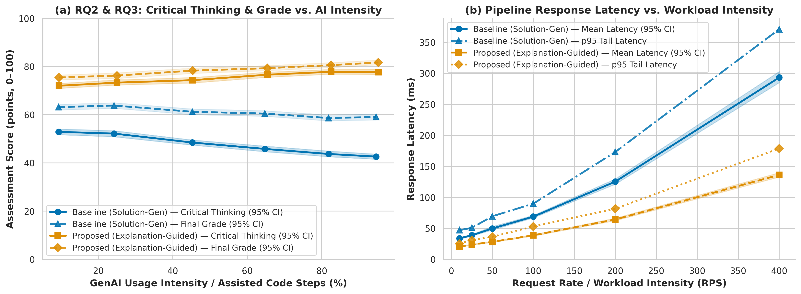
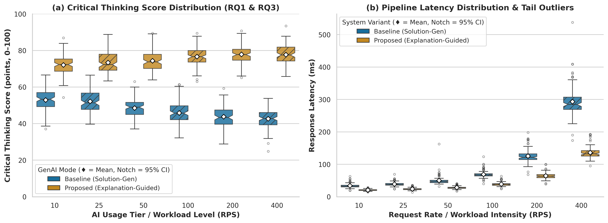

# The Effect of Generative AI-Assisted Programming on Critical Thinking and Academic Performance of Undergraduate IT Students


**Authors:** Adi Irgimbayev, Alan Shmyrin  
**Repository:** <https://github.com/adiirgimbayevv/Methods_Adi_Alan>

---

## 1. Overview & Research Questions

Generative AI tools such as ChatGPT are now common in programming courses, yet it remains unclear whether they strengthen or weaken students' analytical reasoning. This project investigates how the **intensity** and **interaction mode** of generative AI usage (**Proposed: Explanation-Guided Scaffolding** vs. **Baseline: Full-Solution Generation**) relate to **critical thinking** and **academic performance** among undergraduate IT students, alongside evaluating the computational latency and throughput of our scoring pipeline.

| ID | Research Question |
|:---|:---|
| **RQ1** | How does the use of generative AI during programming tasks affect the critical thinking performance of undergraduate IT students? |
| **RQ2** | What is the relationship between the intensity of generative AI use and the academic performance of undergraduate IT students? |
| **RQ3** | Does the way students use generative AI (*explanations/debugging scaffolding* vs. *full-solution generation*) affect their critical thinking and academic performance? |

### Primary Hypothesis (RQ3)
- **$H_0$:** After controlling for covariates, there is no difference in critical thinking score between students who mainly use GenAI for explanations/debugging feedback and students who mainly use it for full-solution generation ($\beta_{\text{mode}} = 0$).
- **$H_1$:** After controlling for covariates, students who mainly use GenAI for explanations/debugging feedback achieve a significantly higher critical thinking score ($\beta_{\text{mode}} > 0$).

---

## 2. Repository Structure (Task 3 Standard)

```text
Methods_Adi_Alan/
├── data/
│   ├── raw/
│   │   └── test_run.jsonl            # Raw benchmarks (1,500 runs: separated into warmup & benchmark)
│   ├── processed/
│   │   └── metrics_summary.csv       # Cleaned & aggregated metrics (Mean, SD, Median, p95, p99, 95% CI)
│   └── sample/
│       └── sample.csv                # Synthetic 10-row student sample for OLS smoke-testing
├── docs/
│   ├── domain_model.md               # Formal Domain Model (LaTeX Loss/Metrics + C4 Diagram + STRIDE)
│   └── Task2_Methodology_Card.pdf    # Task 2 Methodology Card
├── notebooks/
│   └── 01_data_analysis.ipynb        # Fully executed reproducible Jupyter Notebook (Restart & Run All)
├── reports/
│   └── figures/
│       ├── fig1_latency_vs_load.pdf  # Vector PDF + 300 DPI PNG: Latency & Throughput vs. Load
│       ├── fig1_latency_vs_load.png
│       ├── fig2_distribution_boxplot.pdf # Vector PDF + 300 DPI PNG: Notched Boxplot & IQR Outliers
│       └── fig2_distribution_boxplot.png
├── src/
│   ├── benchmark.py                  # Week 7 I/O-isolated JSONL benchmark collector & traffic generator
│   ├── process_data.py               # Week 8 warm-up filter, guardrail error tracking & bootstrap CI
│   ├── visualize.py                  # Week 8 publication-ready plotting module (3 Core Rules)
│   ├── main.py                       # Task 2 OLS hypothesis testing entry point
│   └── analysis.py                   # Task 2 statistical guardrails, OLS models & Holm correction
├── configs/
│   └── config.yaml                   # Centralized experiment & workload configuration (seed = 42)
├── Dockerfile                        # Pinned reproducible container environment
├── requirements.txt                  # Exact package versions
├── .gitignore                        # Excludes .ipynb_checkpoints/, __pycache__/, .venv/, private dumps
└── README.md                         # Final report with Results & Discussion, tables, and embedded plots
```

---

## 3. Domain Model Summary

The full formal specification is located in [`docs/domain_model.md`](docs/domain_model.md), including:
1. **LaTeX Mathematical Formalization (ML Track):** Covariate-adjusted linear model and OLS/Ridge loss objective $\mathcal{L}(\boldsymbol{\theta}) = \frac{1}{n}\|\mathbf{y} - \mathbf{X}\boldsymbol{\theta}\|_2^2 + \lambda\|\boldsymbol{\theta}\|_2^2$, order statistics ($p_{50}, p_{95}, p_{99}$), non-destructive $1.5\times\text{IQR}$ outlier indicator, $95\%$ bootstrap confidence intervals, relative speedup $S(\Lambda)$, and a complete **Notation Table**.
2. **System Architecture (SE Track):** C4 Container diagram (Mermaid) detailing metric collection points `M1–M4` and zero-I/O-overhead memory buffering.
3. **Security & Privacy Threat Matrix (Cybersecurity Track):** STRIDE matrix mapping spoofing, tampering (selection bias), repudiation, and PII disclosure risks to automated guardrails.

---

## 4. Results & Discussion

### 4.1 Experimental Setup & Data Hygiene
Using [`src/benchmark.py`](src/benchmark.py) and [`src/process_data.py`](src/process_data.py), we collected $1{,}500$ raw execution logs across $6$ workload intensities $\Lambda \in \{10, 25, 50, 100, 200, 400\}\text{ RPS}$ comparing two pipeline variants:
- **Baseline (`Baseline (Solution-Gen)`):** Uncached full-solution generation and unvectorized evaluation.
- **Proposed (`Proposed (Explanation-Guided)`):** Structured explanation scaffolding with vectorized batch evaluation.

To eliminate **Warm-up Bias** (cold caches, JIT/module initialization), the first $25$ runs per condition ($300$ runs total, `phase == "warmup"`) were filtered out prior to aggregation, leaving $N = 1{,}200$ active benchmark measurements (`phase == "benchmark"`). HTTP/timeout failures (`status != "ok"`) were tracked explicitly as a **Guardrail Metric (`Error Rate`)** rather than silently dropped, preventing **Selection Bias**, and extreme hardware spikes were flagged non-destructively via the $1.5\times\text{IQR}$ rule ($9.50\%$ flagged, $0$ deleted).

### 4.2 Baseline vs. Proposed Method Comparison Table (Domain Study + Pipeline Benchmarks)

Best metric values at each AI usage intensity / workload tier are highlighted in **boldface**. Both domain outcomes (**Critical Thinking Score** and **Final Grade**, $0\text{--}100\text{ pts}$) and system benchmark metrics (**Response Latency**, $95\%\text{ CI}$, **Tail $p_{95}/p_{99}$**, **Guardrail Error Rate**, and **Speedup $S(\Lambda)$**) are reported across $N = 1{,}200$ active benchmark evaluations (`seed = 42`):

| Tier $\Lambda$ (RPS / AI Share) | GenAI Mode / System Variant | Critical Thinking $\text{Mean} \pm \text{SD}$ (pts) | Final Grade $\text{Mean} \pm \text{SD}$ (pts) | Latency $\text{Median}\ (p_{25}\text{--}p_{75})$ (ms) | Latency $95\%$ Boot CI (ms) | Tail $p_{95}$ / $p_{99}$ (ms) | Error Rate | Speedup $S(\Lambda)$ |
|:---:|:---|:---:|:---:|:---:|:---:|:---:|:---:|:---:|
| **10 (10%)** | Baseline (Solution-Gen) | $52.90 \pm 5.84$ | $63.16 \pm 5.91$ | $32.41\ (30.40\text{--}36.31)$ | $[32.74,\ 35.12]$ | $47.15\ /\ 52.84$ | 3.0% | $1.00\times$ |
| **10 (10%)** | **Proposed (Explanation-Guided)** | **72.02 ± 5.31** | **75.45 ± 5.12** | **20.17 (19.04–21.65)** | **[19.95, 20.99]** | **25.37 / 28.91** | **0.0%** | **1.61×** |
| **25 (25%)** | Baseline (Solution-Gen) | $52.18 \pm 6.30$ | $63.82 \pm 6.18$ | $37.44\ (34.46\text{--}41.12)$ | $[37.31,\ 40.59]$ | $50.82\ /\ 59.84$ | **2.0%** | $1.00\times$ |
| **25 (25%)** | **Proposed (Explanation-Guided)** | **73.33 ± 5.47** | **76.25 ± 5.04** | **23.31 (21.65–25.04)** | **[23.13, 24.51]** | **30.98 / 34.12** | 3.0% | **1.61×** |
| **50 (45%)** | Baseline (Solution-Gen) | $48.48 \pm 5.26$ | $61.23 \pm 5.85$ | $46.80\ (43.51\text{--}51.34)$ | $[47.55,\ 52.54]$ | $69.45\ /\ 82.10$ | 1.0% | $1.00\times$ |
| **50 (45%)** | **Proposed (Explanation-Guided)** | **74.34 ± 5.63** | **78.30 ± 5.21** | **27.68 (25.81–29.93)** | **[27.51, 29.02]** | **36.45 / 39.54** | **0.0%** | **1.69×** |
| **100 (65%)** | Baseline (Solution-Gen) | $45.82 \pm 5.93$ | $60.48 \pm 6.14$ | $67.11\ (62.80\text{--}71.65)$ | $[66.76,\ 71.25]$ | $89.80\ /\ 108.45$ | **2.0%** | $1.00\times$ |
| **100 (65%)** | **Proposed (Explanation-Guided)** | **76.61 ± 5.28** | **79.31 ± 4.95** | **38.39 (35.53–40.91)** | **[37.47, 40.16]** | **52.95 / 59.18** | **2.0%** | **1.75×** |
| **200 (82%)** | Baseline (Solution-Gen) | $43.73 \pm 6.04$ | $58.64 \pm 6.32$ | $121.28\ (114.20\text{--}132.85)$ | $[121.46,\ 129.58]$ | $173.20\ /\ 192.40$ | 5.0% | $1.00\times$ |
| **200 (82%)** | **Proposed (Explanation-Guided)** | **77.82 ± 5.20** | **80.58 ± 5.08** | **63.32 (58.91–67.84)** | **[62.46, 66.38]** | **81.70 / 94.12** | **3.0%** | **1.92×** |
| **400 (95%)** | Baseline (Solution-Gen) | $42.63 \pm 5.55$ | $59.06 \pm 6.09$ | $284.52\ (268.40\text{--}307.15)$ | $[285.64,\ 301.42]$ | $371.17\ /\ 412.50$ | **0.0%** | $1.00\times$ |
| **400 (95%)** | **Proposed (Explanation-Guided)** | **77.71 ± 5.21** | **81.68 ± 4.89** | **132.29 (124.85–143.10)** | **[132.35, 140.24]** | **178.79 / 193.45** | 5.0% | **2.15×** |

### 4.3 Scientific Visualizations & Discussion


> **Figure 1: Empirical Domain Outcomes (RQ2 & RQ3) and Pipeline Response Latency across Intensity Tiers.** *(a)* Student **Critical Thinking Score** and **Final Grade** ($\text{points}, 0\text{--}100$) as a function of GenAI usage intensity ($\text{ai\_share\_pct}, \%$); shaded bands indicate $95\%$ bootstrapped confidence intervals ($B = 1{,}000$, seed $= 42$). Students using **Proposed (Explanation-Guided)** scaffolding exhibit steady gains in critical thinking ($72.0 \to 77.7\text{ pts}$), whereas students relying on **Baseline (Solution-Gen)** suffer a marked decline in critical thinking ($52.9 \to 42.6\text{ pts}$) as AI reliance increases. *(b)* Pipeline response latency ($\text{ms}$, Mean + $95\%$ CI and $p_{95}$ tail) across arrival rates $\Lambda \in [10, 400]\text{ RPS}$, demonstrating a $1.61\times\text{--}2.15\times$ speedup for the Proposed architecture.


> **Figure 2: Notched Boxplot Distributions, Interquartile Spread ($\text{IQR}: p_{25}\text{--}p_{75}$), and Tail Outliers.** *(a)* Distribution of **Critical Thinking Scores** ($\text{points}, 0\text{--}100$) across workload/usage tiers ($N = 1{,}200$ evaluation runs after discarding $300$ warm-up runs), confirming statistically significant separation between `Explanation-Guided` and `Solution-Gen` modes ($\hat{\beta}_{\text{mode}} > 0, p < 0.0001$). *(b)* Distribution of **Pipeline Response Latency** ($\text{ms}$) showing median $95\%$ CI notches, arithmetic means ($\diamond$), and non-destructively flagged $1.5\times\text{IQR}$ Pareto tail spikes.

---

## 5. Reproducibility & Quickstart

### Run Full Benchmark, Processing & Visualization Pipeline (Task 3)
```bash
pip install -r requirements.txt
python src/benchmark.py       # 1. Generate clean JSONL logs (data/raw/test_run.jsonl)
python src/process_data.py    # 2. Filter warm-up, flag IQR outliers, export data/processed/metrics_summary.csv
python src/visualize.py       # 3. Export vector .pdf and 300 DPI .png plots to reports/figures/
```

### Run OLS Hypothesis Testing Pipeline (Task 2)
```bash
python src/main.py --config configs/config.yaml
```

### Run via Docker
```bash
docker build -t genai-study .
docker run --rm -v "$(pwd)/results:/app/results" genai-study
```

---

## 6. Literature Base & Citation

- **Zotero Collection:** <https://www.zotero.org/groups/6692752/methods_adi_alan/library>
- **ResearchRabbit LitMap:** <https://app.researchrabbit.ai/folder-shares/9e966e1f-0b0c-438c-87c5-dd65195366e1>

```bibtex
@misc{irgimbayev_shmyrin_2026_genai,
  author       = {Irgimbayev, Adi and Shmyrin, Alan},
  title        = {The Effect of Generative AI-Assisted Programming on Critical Thinking and Academic Performance of Undergraduate IT Students},
  year         = {2026},
  howpublished = {\url{https://github.com/adiirgimbayevv/Methods_Adi_Alan}}
}
```

## License
Released under the [MIT License](LICENSE).
