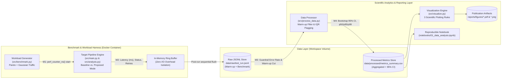

# Formal Domain & System Model (Week 9 Artifact)

**Project:** The Effect of Generative AI-Assisted Programming on Critical Thinking and Academic Performance of Undergraduate IT Students  
**Authors:** Adi Irgimbayev, Alan Shmyrin  
**Tracks Covered:** Machine Learning / Statistical Modeling (Primary) + Software Engineering (C4 Architecture) + Cybersecurity (STRIDE Guardrails)

---

## 1. Mathematical Formulation & Loss Function (ML / Statistical Track)

### 1.1 Covariate-Adjusted Linear Model & OLS Loss ($\mathcal{L}$)

To estimate the causal/associational impact of the Generative AI interaction mode (**Proposed: Explanation-Guided Scaffolding** vs. **Baseline: Full-Solution Generation**) on students' critical thinking scores, we formulate a parameterized linear model over $n$ observations:

$$
y_i = \underbrace{\beta_0}_{\text{Intercept}} + \underbrace{\beta_{\text{mode}} \cdot m_i}_{\text{Focal Treatment Effect}} + \underbrace{\mathbf{z}_i^\top \boldsymbol{\gamma}}_{\text{Confounding Controls}} + \underbrace{\varepsilon_i}_{\text{Gaussian Noise}}, \quad \varepsilon_i \sim \mathcal{N}(0, \sigma^2)
$$

The model parameters $\boldsymbol{\theta} = [\beta_0, \beta_{\text{mode}}, \boldsymbol{\gamma}^\top]^\top \in \mathbb{R}^p$ are optimized by minimizing the **Ordinary Least Squares (OLS) / Ridge-Regularized Objective Function** $\mathcal{L}(\boldsymbol{\theta})$:

$$
\mathcal{L}(\boldsymbol{\theta}) = \underbrace{\frac{1}{n} \sum_{i=1}^{n} \left( y_i - \left( \beta_0 + \beta_{\text{mode}} m_i + \mathbf{z}_i^\top \boldsymbol{\gamma} \right) \right)^2}_{\text{Empirical MSE Fidelity Term}} + \underbrace{\lambda \|\boldsymbol{\theta}\|_2^2}_{\text{L2 Stability Regularization}} = \frac{1}{n} \|\mathbf{y} - \mathbf{X}\boldsymbol{\theta}\|_2^2 + \lambda \|\boldsymbol{\theta}\|_2^2
$$

When $\lambda = 0$ (standard unregularized OLS with Variance Inflation Factor $\text{VIF}_j < 5.0$), the exact closed-form estimator is:

$$
\hat{\boldsymbol{\theta}} = (\mathbf{X}^\top \mathbf{X})^{-1} \mathbf{X}^\top \mathbf{y}, \qquad \widehat{\text{Cov}}(\hat{\boldsymbol{\theta}}) = \hat{\sigma}^2 (\mathbf{X}^\top \mathbf{X})^{-1}
$$

### 1.2 Formal Definitions of Benchmark & Evaluation Metrics

For both empirical hypothesis testing and pipeline performance benchmarking across workload intensities $\Lambda \in \{10, 25, 50, 100, 200, 400\}\text{ RPS}$, we define the following aggregated metrics over $N$ valid benchmark runs $\{L_1, L_2, \dots, L_N\}$:

1. **Order Statistics & Tail Quantiles ($p_{50}, p_{95}, p_{99}$):**
   Let $L_{(1)} \le L_{(2)} \le \dots \le L_{(N)}$ denote the sorted response latencies after discarding cold-start warm-up runs ($\text{phase} = \text{warmup}$). The $q$-th percentile $p_{100q}$ is defined as:
   $$
   p_{100q} = Q_q(\{L_i\}_{i=1}^N) = L_{(\lceil q \cdot N \rceil)}, \quad q \in \{0.25, 0.50, 0.75, 0.95, 0.99\}
   $$

2. **Non-Destructive Interquartile Outlier Boundary ($\text{IQR}$):**
   $$
   \text{IQR} = p_{75} - p_{25}, \qquad \text{Outlier}(L_i) = \mathbb{I}\!\left( L_i < p_{25} - 1.5\,\text{IQR} \;\lor\; L_i > p_{75} + 1.5\,\text{IQR} \right)
   $$

3. **95% Bootstrapped Confidence Interval ($\text{CI}_{95\%}$):**
   Given $B = 1{,}000$ bootstrap resamples $\{\hat{\mu}^{*(1)}, \dots, \hat{\mu}^{*(B)}\}$ drawn with replacement (fixed seed $s = 42$):
   $$
   \text{CI}_{95\%}(\mu) = \left[ Q_{0.025}\!\left(\{\hat{\mu}^{*(b)}\}_{b=1}^B\right),\; Q_{0.975}\!\left(\{\hat{\mu}^{*(b)}\}_{b=1}^B\right) \right]
   $$

4. **Relative Latency Speedup Ratio ($S$) & Incremental Variance Explained ($\Delta R^2$):**
   $$
   S(\Lambda) = \frac{\text{Median}(L_{\text{Baseline}}(\Lambda))}{\text{Median}(L_{\text{Proposed}}(\Lambda))}, \qquad \Delta R^2 = R^2_{\text{full}} - R^2_{\text{null}} = \frac{\text{SSR}_{\text{full}} - \text{SSR}_{\text{null}}}{\text{SST}}
   $$

5. **Guardrail Error Rate ($E_{\text{guard}}$) & Internal Scale Consistency (Cronbach's $\alpha_C$):**
   $$
   E_{\text{guard}} = \frac{1}{N_{\text{total}}} \sum_{i=1}^{N_{\text{total}}} \mathbb{I}(\text{status}_i \neq \text{ok}) < 0.05, \qquad \alpha_C = \frac{k}{k-1}\left( 1 - \frac{\sum_{j=1}^k s_j^2}{s_T^2} \right) \ge 0.70
   $$

---

## 2. Mathematical Notation Table

| Symbol | Mathematical Domain | Type | Description & Physical Units |
|:---|:---|:---|:---|
| $n, N$ | $\mathbb{N}^+$ | Scalar | Number of student respondents ($n$) / active benchmark evaluations ($N$) |
| $y_i$ | $[0, 100] \subset \mathbb{R}$ | Scalar | Critical Thinking (CT) assessment score of student $i$ (points) |
| $m_i$ | $\{0, 1\}$ | Binary Scalar | GenAI interaction mode ($0 = \text{Solution-Gen Baseline}$, $1 = \text{Explanation-Guided Proposed}$) |
| $\mathbf{z}_i$ | $\mathbb{R}^{p-2}$ | Column Vector | Control covariates (prior GPA, programming experience, study hours, task difficulty) |
| $\mathbf{X}$ | $\mathbb{R}^{n \times p}$ | Design Matrix | Full feature matrix including intercept, treatment $m_i$, and covariates $\mathbf{z}_i^\top$ |
| $\boldsymbol{\theta}, \hat{\boldsymbol{\theta}}$ | $\mathbb{R}^p$ | Parameter Vector | True and OLS-estimated regression coefficients $[\beta_0, \beta_{\text{mode}}, \boldsymbol{\gamma}^\top]^\top$ |
| $\mathcal{L}(\boldsymbol{\theta})$ | $\mathbb{R}_{\ge 0}$ | Objective Function | Ordinary Least Squares (OLS) / Ridge loss function |
| $L_i$ | $\mathbb{R}_{> 0}$ | Random Variable | Single-request execution latency measured in milliseconds ($\text{ms}$) |
| $\Lambda$ | $\mathbb{R}_{> 0}$ | Scalar | Workload intensity / target request arrival rate ($\text{RPS}$, req/sec) |
| $T(\Lambda)$ | $\mathbb{R}_{> 0}$ | Scalar | Effective achieved system throughput ($\text{req/sec}$) |
| $p_{50}, p_{95}, p_{99}$ | $\mathbb{R}_{> 0}$ | Scalar | Median ($50\text{th}$), $95\text{th}$, and $99\text{th}$ tail latency percentiles ($\text{ms}$) |
| $\text{IQR}$ | $\mathbb{R}_{\ge 0}$ | Scalar | Interquartile range $p_{75} - p_{25}$ ($\text{ms}$) |
| $\text{CI}_{95\%}$ | $[a, b] \subset \mathbb{R}^2$ | Interval | $95\%$ non-parametric bootstrap confidence interval ($B = 1{,}000$, seed $= 42$) |
| $S(\Lambda)$ | $\mathbb{R}_{> 0}$ | Dimensionless Ratio | Relative speedup of Proposed vs. Baseline pipeline at load $\Lambda$ ($\times$) |

---

## 3. System Architecture & Metric Collection Nodes (SE Track — C4 Container Model)

The Mermaid diagram below illustrates the C4 Container view of our reproducible benchmark and statistical analysis pipeline, explicitly highlighting the **Metric Collection Points (M1–M4)** and **Trust/Isolation Boundaries**:

---

## 4. Security & Data Privacy Threat Model (Cybersecurity Track — STRIDE Matrix)

Because the study processes student academic records and GenAI interaction logs, our pipeline enforces automated privacy and integrity guardrails (`src/analysis.py` & `src/process_data.py`):

| STRIDE Category | Threatened Component | Concrete Threat Scenario | Implemented Mitigation / Guardrail |
|:---|:---|:---|:---|
| **S** — Spoofing | Survey / Log Ingestion (`data/raw/`) | Synthetic or duplicate respondent IDs injected into dataset | Unique `id` schema validation and deterministic run indexing |
| **T** — Tampering | Benchmark Logs (`test_run.jsonl`) | Manual deletion of failed/timeout runs causing Selection Bias | Non-destructive outlier flagging (`is_outlier`) + explicit `error_rate` guardrail |
| **R** — Repudiation | Statistical Pipeline (`src/main.py`) | Unreproducible $p$-values or bootstrap intervals across machines | Fixed PRNG seed (`random_seed: 42`), pinned Docker image, timestamped `results/run.log` |
| **I** — Information Disclosure | Git Repository & Raw Data | Accidental commit of student PII (`name`, `email`, `phone`) | Automated `FORBIDDEN_COLUMNS` guardrail check + strict `.gitignore` rules on `data/raw/*` |
| **D** — Denial of Service | Evaluation Runner (`configs/config.yaml`) | Infinite hang or memory exhaustion under giant payload edge cases | Enforced `timeout_seconds: 300`, bounded container CPU/RAM, rate-limit HTTP 429 tracking |
| **E** — Elevation of Privilege | Container Execution (`Dockerfile`) | Arbitrary code execution via untrusted config deserialization | Safe YAML parsing (`yaml.safe_load`) and isolated non-privileged container volume mounts |
