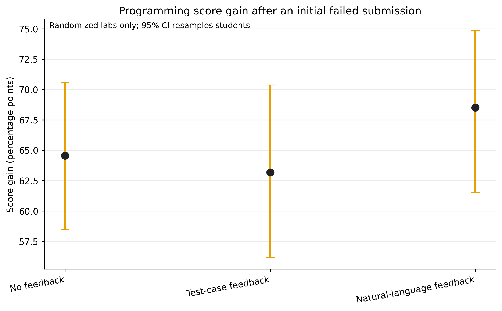
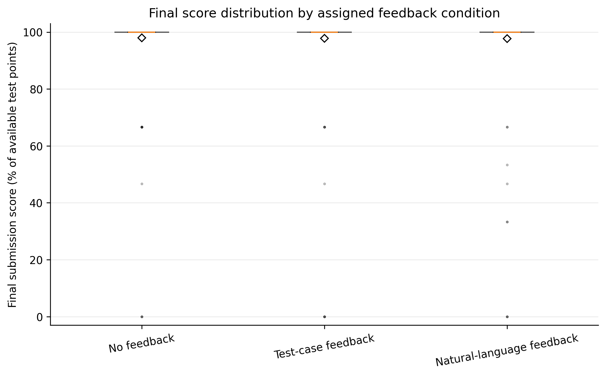
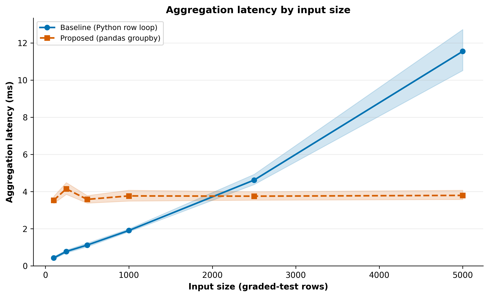
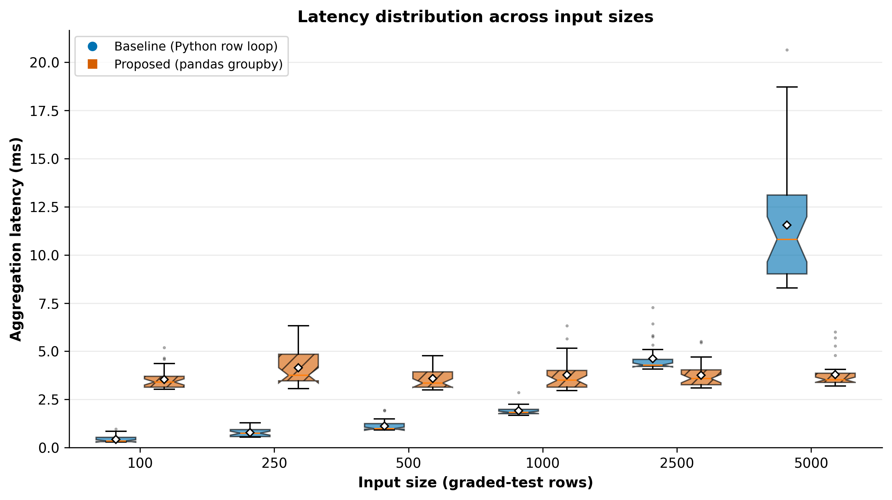

# Section 4: Results and discussion

**Title:** AI-Generated Feedback and Programming Outcomes in Introductory Python  
**Authors:** Adi Irgimbayev, Alan Shmyrin  
**Empirical source:** ProgFeed classroom dataset, CC BY 4.0

## 4.1 Data and analysis

The analysis uses the public, de-identified ProgFeed dataset: 17,385 graded-test rows from 215 consenting students, grouped into 6,693 submissions. The source is one row per graded test/function within a submission. We aggregate rows to a submission score (earned points divided by available points), then form student-lab trajectories.

Only labs 05, 06, 07, and 09 are included in feedback-arm comparisons because those labs randomized students to no feedback, test-case feedback (tc), or natural-language feedback (nl). The analytic unit is student × lab. The outcome shown below is the change between first and last observed submission, among units whose first submission failed. Confidence intervals use student-cluster bootstrap resampling (seed 42; 5,000 draws).

The public dataset has no validated critical-thinking measure. The analysis therefore concerns programming performance and submission behavior only.

## 4.2 Descriptive results

| Assigned feedback | Student-lab units | First attempt failed | Retry rate | Eventually full credit | Mean score gain (percentage points) | Student-cluster bootstrap 95% CI |
|:--|--:|--:|--:|--:|--:|:--|
| No feedback | 271 | 93 | 97.8% | 91.4% | 64.55 | [58.48, 70.54] |
| Test-case hint | 268 | 91 | 95.6% | 90.1% | 63.19 | [56.16, 70.37] |
| Natural-language hint | 264 | 96 | 96.9% | 92.7% | 68.51 | [61.55, 74.83] |

The table describes assigned arms; feedback text was not delivered on every record because the tool only generated feedback following a failing submission. These estimates are not claims that the natural-language arm caused a larger learning gain. The outcome is measured across multiple submissions, and the final observed submission may be incomplete.

## 4.3 Local data-processing benchmark

We measured two implementations of the same aggregation over rows from the public ProgFeed CSV: a Python row loop and a pandas groupby. The run recorded 420 timings across six input sizes, including 60 warm-up runs; the remaining 360 measurements are summarized below. The timing unit is milliseconds, throughput is rows per second, and error rate is the share of timed operations that raised an exception.

| Input rows | Baseline median (ms) | Proposed median (ms) | Baseline p95 (ms) | Proposed p95 (ms) | Proposed speedup | Error rate |
|--:|--:|--:|--:|--:|--:|--:|
| 100 | 0.345 | 3.408 | 0.777 | 4.622 | 0.10x | 0% |
| 250 | 0.749 | 3.752 | 1.093 | 5.707 | 0.20x | 0% |
| 500 | 0.980 | 3.352 | 1.721 | 4.667 | 0.29x | 0% |
| 1,000 | 1.830 | 3.494 | 2.217 | 5.434 | 0.52x | 0% |
| 2,500 | 4.287 | 3.584 | 6.154 | 5.114 | 1.20x | 0% |
| 5,000 | 10.813 | 3.523 | 17.504 | 5.507 | 3.07x | 0% |

The pandas groupby has a higher fixed setup cost and is slower at small inputs; it becomes faster than the loop at 2,500 rows in this local run. This is a benchmark of the repository’s aggregation code on the current machine, not AI service or network latency.

## 4.4 Limitations

- There is no direct measure of critical thinking or long-term retention.
- Only four randomized labs support comparisons of assigned feedback arms.
- Assigned arm and feedback delivery differ because feedback appears only after errors.
- Repeated student-lab observations are clustered by student; confidence intervals account for this clustering.
- Findings from one introductory Python course may not generalize to other classes or forms of AI assistance.

## 4.5 Data citation

Heickal, H. & Lan, A. (2026). “A Classroom Study of LLM-generated Feedback Intervention in Introductory Programming.” *Proceedings of the Impactful and Responsible AI Systems for Education Workshop*, PMLR 339, 12–21. [Paper](https://proceedings.mlr.press/v339/heickal26a.html). Dataset: [ProgFeed public repository](https://github.com/umass-ml4ed/progFeed-dataset-public).
