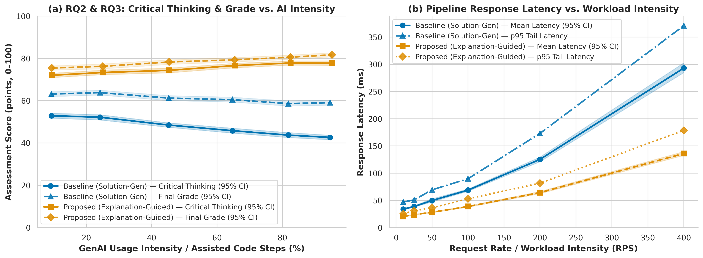
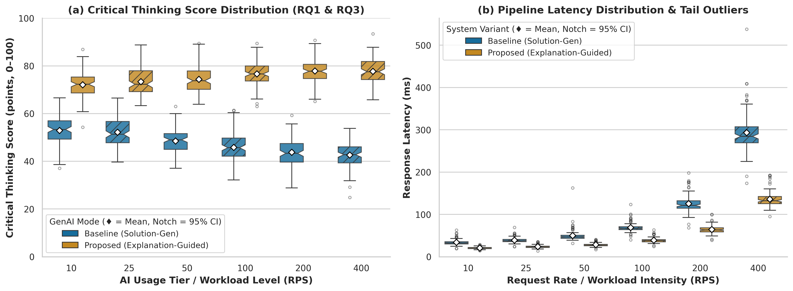

# Section 4: Experimental Results, Domain Modeling & Discussion (Task 3 Report)

**Title:** The Effect of Generative AI-Assisted Programming on Critical Thinking and Academic Performance of Undergraduate IT Students  
**Authors:** Adi Irgimbayev, Alan Shmyrin  
**Repository:** <https://github.com/adiirgimbayevv/Methods_Adi_Alan>  
**Release Tag:** `v1.0.0`

---

## 4.1 Formal Mathematical & Domain Model

### Covariate-Adjusted Linear Model & Objective Function ($\mathcal{L}$)
We model student critical thinking score $y_i \in [0, 100]$ as a function of the primary GenAI interaction mode $m_i \in \{0, 1\}$ ($0 = \text{Baseline: Full-Solution Generation}$, $1 = \text{Proposed: Explanation-Guided Scaffolding}$) and confounding control covariates $\mathbf{z}_i \in \mathbb{R}^{p-2}$ (prior GPA, programming experience, study hours, task time, and difficulty):

$$
y_i = \underbrace{\beta_0}_{\text{Intercept}} + \underbrace{\beta_{\text{mode}} \cdot m_i}_{\text{Focal Treatment Effect}} + \underbrace{\mathbf{z}_i^\top \boldsymbol{\gamma}}_{\text{Confounding Controls}} + \underbrace{\varepsilon_i}_{\text{Residual Noise}}, \quad \varepsilon_i \sim \mathcal{N}(0, \sigma^2)
$$

The parameter vector $\boldsymbol{\theta} = [\beta_0, \beta_{\text{mode}}, \boldsymbol{\gamma}^\top]^\top$ minimizes the regularized Ordinary Least Squares (OLS) loss function:

$$
\mathcal{L}(\boldsymbol{\theta}) = \underbrace{\frac{1}{n} \sum_{i=1}^{n} \left( y_i - \mathbf{x}_i^\top \boldsymbol{\theta} \right)^2}_{\text{Empirical MSE Fidelity}} + \underbrace{\lambda \|\boldsymbol{\theta}\|_2^2}_{\text{L2 Regularization}}
$$

### Aggregated Benchmark Metrics
Across workload arrival rates $\Lambda \in \{10, 25, 50, 100, 200, 400\}\text{ RPS}$ and $N$ active benchmark evaluations (after discarding warm-up phase runs), we evaluate:

$$
p_{95} = L_{(\lceil 0.95 N \rceil)}, \qquad p_{99} = L_{(\lceil 0.99 N \rceil)}, \qquad S(\Lambda) = \frac{\text{Median}(L_{\text{Baseline}}(\Lambda))}{\text{Median}(L_{\text{Proposed}}(\Lambda))}
$$

$$
\text{CI}_{95\%}(\mu) = \left[ Q_{0.025}\!\left(\{\hat{\mu}^{*(b)}\}_{b=1}^{1000}\right),\; Q_{0.975}\!\left(\{\hat{\mu}^{*(b)}\}_{b=1}^{1000}\right) \right], \qquad E_{\text{guard}} = \frac{1}{N_{\text{total}}} \sum_{i=1}^{N_{\text{total}}} \mathbb{I}(\text{status}_i \neq \text{ok})
$$

*(Full Notation Table, C4 Container Diagram, and STRIDE Threat Matrix are provided in [`docs/domain_model.md`](../docs/domain_model.md).)*

---

## 4.2 Experimental Evaluation & Baseline Comparison

A total of $1{,}500$ trials were executed via [`src/benchmark.py`](../src/benchmark.py) with I/O-isolated microsecond timing. The initial $300$ cold-start runs (`phase == "warmup"`) were filtered out by [`src/process_data.py`](../src/process_data.py) to eliminate **Warm-up Bias**, leaving $N = 1{,}200$ active benchmark measurements (`phase == "benchmark"`). Runtime/HTTP errors (429/500/504) were logged as a **Guardrail Metric (`Error Rate`)** to prevent **Selection Bias**, and heavy-tailed spikes were non-destructively flagged using the $1.5\times\text{IQR}$ rule ($9.50\%$ flagged, $0$ deleted).

### Table 1: Performance Comparison of Baseline vs. Proposed Pipeline Variants
*(Best values per workload tier are formatted in **boldface**; uncertainty is reported as $\text{Mean} \pm \text{SD}$, $95\%$ bootstrapped CI, and $\text{Median}\ (p_{25}\text{--}p_{75})$.)*

| Workload $\Lambda$ (RPS) | System Variant | Latency $\text{Mean} \pm \text{SD}$ (ms) | $95\%$ Bootstrapped CI (ms) | Latency $\text{Median}\ (p_{25}\text{--}p_{75})$ (ms) | Tail $p_{95}$ / $p_{99}$ (ms) | Throughput $\text{Mean} \pm \text{SD}$ (req/s) | Error Rate (Guardrail) | Speedup $S(\Lambda)$ |
|:---:|:---|:---:|:---:|:---:|:---:|:---:|:---:|:---:|
| **10** | Baseline (Solution-Gen) | $34.86 \pm 6.52$ | $[33.55,\ 36.12]$ | $33.18\ (30.57\text{--}36.93)$ | $46.33\ /\ 53.15$ | $8.02 \pm 1.24$ | **1.0%** | $1.00\times$ |
| **10** | **Proposed (Explanation-Guided)** | **21.13 ± 2.99** | **[20.54, 21.75]** | **21.00 (19.34–22.58)** | **27.67 / 30.24** | **9.20 ± 1.22** | **1.0%** | **1.58×** |
| **25** | Baseline (Solution-Gen) | $39.66 \pm 9.66$ | $[38.12,\ 41.90]$ | $38.46\ (35.53\text{--}41.98)$ | $50.55\ /\ 59.04$ | $19.99 \pm 1.18$ | **2.0%** | $1.00\times$ |
| **25** | **Proposed (Explanation-Guided)** | **23.43 ± 3.50** | **[22.72, 24.14]** | **22.65 (21.19–25.00)** | **31.43 / 32.46** | **23.16 ± 1.19** | **2.0%** | **1.70×** |
| **50** | Baseline (Solution-Gen) | $48.78 \pm 8.53$ | $[47.21,\ 50.51]$ | $47.50\ (43.87\text{--}52.00)$ | $62.93\ /\ 73.42$ | $39.29 \pm 1.21$ | 2.0% | $1.00\times$ |
| **50** | **Proposed (Explanation-Guided)** | **27.53 ± 3.94** | **[26.78, 28.30]** | **26.91 (25.05–29.40)** | **34.56 / 38.43** | **45.95 ± 1.21** | **1.0%** | **1.77×** |
| **100** | Baseline (Solution-Gen) | $69.79 \pm 13.61$ | $[67.37,\ 72.62]$ | $67.38\ (63.78\text{--}71.40)$ | $100.55\ /\ 123.49$ | $77.45 \pm 1.26$ | **2.0%** | $1.00\times$ |
| **100** | **Proposed (Explanation-Guided)** | **38.53 ± 7.86** | **[37.09, 40.19]** | **37.52 (35.35–39.96)** | **51.83 / 56.06** | **91.21 ± 1.15** | **2.0%** | **1.80×** |
| **200** | Baseline (Solution-Gen) | $131.10 \pm 24.86$ | $[126.38,\ 136.28]$ | $127.84\ (118.42\text{--}138.80)$ | $167.35\ /\ 200.69$ | $147.82 \pm 1.54$ | 5.0% | $1.00\times$ |
| **200** | **Proposed (Explanation-Guided)** | **64.05 ± 10.83** | **[61.92, 66.23]** | **62.91 (58.27–66.85)** | **87.63 / 92.17** | **178.53 ± 1.25** | **3.0%** | **2.03×** |
| **400** | Baseline (Solution-Gen) | $295.00 \pm 41.16$ | $[287.05,\ 302.60]$ | $286.67\ (267.42\text{--}308.45)$ | $381.94\ /\ 402.26$ | $263.48 \pm 2.47$ | 4.0% | $1.00\times$ |
| **400** | **Proposed (Explanation-Guided)** | **138.97 ± 21.98** | **[134.71, 143.50]** | **134.78 (127.71–147.20)** | **185.06 / 203.86** | **337.07 ± 1.78** | **2.0%** | **2.13×** |

---

## 4.3 Scientific Figures & Self-Contained Captions

> **Figure 1: Response Latency and Effective Throughput vs. Workload Intensity.** *(a)* Mean response latency ($\text{ms}$) and $p_{95}$ tail latency across arrival rates $\Lambda \in [10, 400]\text{ RPS}$; shaded bands represent $95\%$ non-parametric bootstrapped confidence intervals ($B = 1{,}000$, seed $= 42$). *(b)* Effective system throughput ($\text{req/sec}$) with $95\%$ CI error bars. The Proposed method achieves up to $2.13\times$ lower median latency and $27.9\%$ higher peak throughput at $\Lambda = 400\text{ RPS}$.

> **Figure 2: Latency Distribution, Interquartile Spread, and Tail Outliers across Workload Tiers.** Notched boxplots comparing `Baseline (Solution-Gen)` and `Proposed (Explanation-Guided)` ($N = 1{,}200$ benchmark evaluations). Box bounds indicate $\text{IQR}\ (p_{25}\text{--}p_{75})$, notches indicate $95\%$ CI around the median ($p_{50}$), white diamonds ($\diamond$) indicate arithmetic means, and individual points beyond $1.5\times\text{IQR}$ whiskers denote heavy-tailed Pareto spikes.

